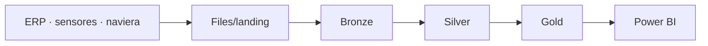

# Operations Lakehouse

Plataforma lakehouse para los datos de operaciones de una agroexportadora **ficticia**: lecturas de sensores de cuartos fríos, eventos de navieras y datos del ERP, integrados con una arquitectura medallion (Bronze, Silver y Gold) sobre Delta Lake. Se desarrolla en local con Docker y se despliega en Microsoft Fabric.

> En construcción. Ver el [plan de trabajo](docs/architecture.md#plan-de-trabajo).

## Arquitectura



Detalle completo en [docs/architecture.md](docs/architecture.md).

## Inicio rápido

El entorno se define en el [Dockerfile](Dockerfile) y se puede ejecutar de dos formas.

**GitHub Codespaces** (sin instalar nada): *Code → Codespaces → Create codespace on main*. La configuración de [.devcontainer](.devcontainer/devcontainer.json) construye la imagen y abre el editor dentro de ella.

```bash
python -m lakehouse check
```

**Docker Compose** (local, requiere Docker con Compose v2):

```bash
docker compose build
docker compose run --rm lakehouse python -m lakehouse check
```

Resultado esperado:

```
Spark 3.5.3
Tabla Delta: /workspace/data/Tables/bronze/_environment_check
  versiones: 2
  qty_kg versión actual: 1750
  qty_kg versión 0:      2000
Entorno correcto.
```

## Pruebas

```bash
python -m pytest                                      # Codespaces
docker compose run --rm lakehouse python -m pytest    # Docker Compose
```

## Estructura

```
lakehouse/      Paquete Python: configuración, sesión Spark y procesos por capa
tests/          Pruebas con Spark local
docs/           Arquitectura y decisiones de diseño
data/           Lakehouse local (ignorado por Git)
```

## Stack

Apache Spark 3.5 · Delta Lake 3.2 · Python 3.11 · Docker · pytest · Microsoft Fabric
