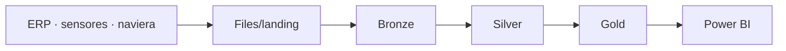

# Operations Lakehouse

Plataforma lakehouse para los datos de operaciones de una agroexportadora **ficticia**: lecturas de sensores de cuartos fríos, eventos de navieras y datos del ERP, integrados con una arquitectura medallion (Bronze, Silver y Gold) sobre Delta Lake. Se desarrolla en local con Docker y se despliega en Microsoft Fabric.

> En construcción. Ver el [plan de trabajo](docs/architecture.md#plan-de-trabajo).

## Arquitectura



Detalle completo en [docs/architecture.md](docs/architecture.md).

## Inicio rápido

El entorno se define en el [Dockerfile](Dockerfile) y se puede ejecutar de dos formas.

**GitHub Codespaces** (sin instalar nada): *Code → Codespaces → Create codespace on main*. La configuración de [.devcontainer](.devcontainer/devcontainer.json) construye la imagen y abre el editor dentro de ella.

```bash
python -m lakehouse check
```

**Docker Compose** (local, requiere Docker con Compose v2):

```bash
docker compose build
docker compose run --rm lakehouse python -m lakehouse check
```

Resultado esperado:

```
Spark 3.5.3
Tabla Delta: /workspace/data/Tables/bronze/_environment_check
  versiones: 2
  qty_kg versión actual: 1750
  qty_kg versión 0:      2000
Entorno correcto.
```

## Datos de origen

```bash
python -m lakehouse generate                      # todo el periodo
python -m lakehouse generate --until 2026-10-13   # solo lo que había llegado hasta esa fecha
```

Genera los archivos del ERP, los sensores de cuartos fríos y la naviera en `data/Files/landing`, con comportamientos de entrega reales: duplicados, datos tardíos, zonas horarias mixtas y evolución de esquema. Detalle en [docs/sources.md](docs/sources.md).

## Ingesta en Bronze

```bash
python -m lakehouse ingest
```

Carga en tablas Delta los archivos nuevos de la zona de aterrizaje, con linaje por fila y un registro por archivo. Es idempotente: un archivo ya ingerido, o uno idéntico con otro nombre, no se vuelve a cargar. Detalle en [docs/architecture.md](docs/architecture.md#bronze).

```
Lote 2
  Tabla             Ingeridos Duplicados Rechazados     Filas
  erp_products              0          0          0         0
  erp_lots                 19          0          0       181
  erp_shipments            16          0          0        44
  sensor_readings          98          1          0    56,448
  carrier_events           20          0          0     3,568
```

## Transformación en Silver

```bash
python -m lakehouse silver
```

Convierte Bronze en tablas tipadas con un registro por clave de negocio, horas en UTC y los registros inválidos en cuarentena con su motivo. Procesa solo los lotes de Bronze nuevos. Detalle en [docs/architecture.md](docs/architecture.md#silver).

```
Lotes de Bronze procesados: 2
  Tabla                 Leídas Cuarentena Descartadas Insertadas Actualizadas
  products                   0          0           0          0            0
  lots                     181          0          57         95           29
  shipments                 44          0           0         44            0
  cold_room_readings    56,448         65           0     56,383            0
  carrier_events         3,568          0          53      3,513            0
```

`Descartadas` son copias repetidas o versiones anteriores de un mismo registro.

## Publicación en Gold

```bash
python -m lakehouse gold        # solo Gold
python -m lakehouse pipeline    # Bronze, Silver, Gold y controles de calidad en orden
```

Calcula las excursiones de temperatura de cada cuarto frío, la exposición de cada lote y el desempeño de cada contenedor, y publica las tablas de forma que un reporte nunca vea una publicación a medias. Detalle en [docs/architecture.md](docs/architecture.md#gold).

```
Excursiones críticas en cuartos fríos
+-----------+-------------------+------------+-----------+----------+
|room_code  |start_utc          |duration_min|peak_temp_c|max_temp_c|
+-----------+-------------------+------------+-----------+----------+
|CR01-LIM-02|2026-10-07 14:40:00|295         |18.7       |13.0      |
+-----------+-------------------+------------+-----------+----------+

Estado de cadena de frío por lote
+-----------------+----+-------+
|cold_chain_status|lots| qty_kg|
+-----------------+----+-------+
|     COMPROMETIDO|   6|  58850|
|        EN_RIESGO|  11|  62750|
|               OK| 288|2694400|
+-----------------+----+-------+
```

## Operación

```bash
python -m lakehouse quality                 # controles de calidad; termina con error si alguno falla
python -m lakehouse silver --full-refresh   # reconstruye Silver desde Bronze tras cambiar una regla
python -m lakehouse maintain                # OPTIMIZE de todas las tablas Delta
python -m lakehouse benchmark               # mide el pipeline con 176 mil y 1.76 millones de lecturas
```

```
  WARN   cobertura_sensores      gold.fact_cold_room_daily     3 días sin lecturas: GT01-ESC-01 2026-10-10, ...

24 controles: 23 PASS, 1 WARN, 0 FAIL
```

Detalle en [docs/architecture.md](docs/architecture.md#calidad-reproceso-y-mantenimiento) y mediciones en [docs/performance.md](docs/performance.md).

## Pruebas

```bash
python -m pytest                                      # Codespaces
docker compose run --rm lakehouse python -m pytest    # Docker Compose
```

## Estructura

```
lakehouse/             Paquete Python: configuración, sesión Spark y procesos por capa
lakehouse/generator/   Simulación de las fuentes de origen
lakehouse/reference/   Datos de referencia: cuartos fríos y tolerancias de alarma
tests/                 Pruebas
docs/                  Arquitectura, contratos de las fuentes y decisiones de diseño
data/                  Lakehouse local (ignorado por Git)
```

## Stack

Apache Spark 3.5 · Delta Lake 3.2 · Python 3.11 · Docker · pytest · Microsoft Fabric
