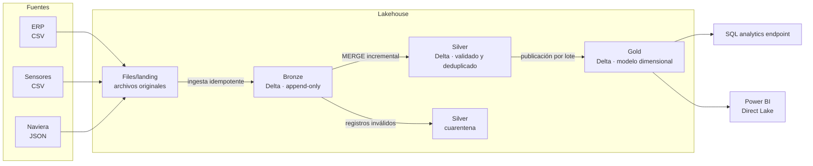

# Arquitectura

## Contexto

AgroExport Demo es una agroexportadora **ficticia** con dos sociedades (CR01 Costa Rica y GT01 Guatemala) que exporta fruta fresca y procesada. Su almacén de ventas y cartera vive en SQL Server ([agroexport-analytics](https://github.com/Joseph5712/agroexport-analytics)).

La operación incorporó fuentes que un almacén relacional maneja mal: lecturas de sensores cada cinco minutos y eventos semiestructurados de navieras. Este proyecto construye una plataforma lakehouse para integrarlas con los datos del ERP.

## Preguntas de negocio

| Área | Pregunta |
|---|---|
| Calidad | ¿Qué lotes salieron del rango de temperatura de su producto, cuándo y por cuánto tiempo? |
| Planta | ¿Qué cuartos fríos acumulan más excursiones de temperatura? |
| Logística | ¿Qué contenedores llegan después de su ETA y en qué tramo se generó el retraso? |
| Gerencia | ¿Cuántos kg en inventario o en tránsito están en riesgo por cadena de frío? |
| Ingeniería | ¿Qué archivo y qué ejecución produjo cada dato publicado? |

## Fuentes

Contratos y comportamientos detallados en [sources.md](sources.md).

| Fuente | Formato | Frecuencia | Contenido | Comportamientos a manejar |
|---|---|---|---|---|
| ERP | CSV | Diaria | Lotes, productos con su rango de temperatura, embarques y contenedores | Correcciones de registros ya enviados |
| Sensores de cuartos fríos | CSV por cuarto y hora | Lecturas cada 5 min | Temperatura y humedad por cuarto | Alto volumen, lecturas duplicadas, sensores que envían horas o días después |
| Naviera | JSON por lote de eventos | Cada hora | Eventos del contenedor: carga, zarpe, arribo, descarga, temperatura del reefer | Esquema que evoluciona, eventos fuera de orden |

## Arquitectura medallion

| Capa | Contenido | Reglas |
|---|---|---|
| **Files/landing** | Archivos tal como llegan, organizados por fuente y fecha de llegada | No se modifican |
| **Bronze** | Un registro por registro de origen, con el contenido original y metadatos de ingesta (`_source_file`, `_file_sha256`, `_ingested_at`, `_batch_id`) | Solo se agregan filas. Un archivo ya ingerido no se vuelve a ingerir |
| **Silver** | Tipos correctos, claves de negocio, un registro por clave y registros inválidos separados en cuarentena | Carga incremental con `MERGE` sobre la clave de negocio |
| **Gold** | Dimensiones, hechos e indicadores de cadena de frío y tránsito | Se publica por lote; el consumo lee solo lotes completos |

## Bronze

Implementado en [`lakehouse/bronze.py`](../lakehouse/bronze.py). Cada ejecución de `python -m lakehouse ingest` es un lote con `batch_id` correlativo.

| Tabla | Origen | Contenido | Partición |
|---|---|---|---|
| `erp_products` | `erp/products.csv` | Columnas del contrato como texto | — |
| `erp_lots` | `erp/lots_*.csv` | Columnas del contrato como texto | — |
| `erp_shipments` | `erp/shipments_*.csv` | Columnas del contrato como texto | — |
| `sensor_readings` | `sensors/*.csv` | Columnas del contrato como texto | `_arrival_date` |
| `carrier_events` | `carrier/*.jsonl` | Línea JSON completa en `payload` | `_arrival_date` |
| `ingestion_log` | — | Una fila por archivo procesado | — |

Todas las tablas de datos agregan las columnas de linaje `_source_file`, `_file_sha256`, `_arrival_date`, `_batch_id` e `_ingested_at`.

**Decisiones:**

- **Todo como texto.** Bronze no interpreta tipos. Un valor inválido (`-99.9`, una fecha mal formada) se conserva tal cual y se evalúa en Silver, de modo que siempre es posible reprocesar desde el original.
- **JSON sin desarmar.** Los eventos de la naviera se guardan como la línea completa. Cuando la versión 2 del esquema agrega campos, la ingesta no cambia; Silver decide qué campos incorpora.
- **Idempotencia por huella.** Un archivo se identifica por su SHA-256, no por su nombre. Un reenvío idéntico con otro nombre se registra como `SKIPPED_DUPLICATE` con la ruta del original en `duplicate_of`.
- **Validación de encabezado.** Un CSV cuyas columnas no coinciden con el [contrato](../lakehouse/contracts.py) se registra como `REJECTED_SCHEMA` y no se cargan sus filas. Para reprocesarlo, la fuente debe enviar el archivo corregido con otro nombre.
- **Registro al final del lote.** Delta Lake confirma cada tabla por separado. El lote se considera completo solo cuando sus archivos están en `ingestion_log`, que se escribe al final. Si una ejecución se interrumpe antes, la siguiente elimina las filas cuyo `_batch_id` no está registrado y vuelve a procesar esos archivos.
- **Partición por fecha de llegada** en las tablas de alto volumen, para que Silver procese solo lo nuevo.

| Estado en `ingestion_log` | Significado |
|---|---|
| `INGESTED` | Filas agregadas; `rows` indica cuántas |
| `SKIPPED_DUPLICATE` | Contenido idéntico a un archivo ya ingerido |
| `REJECTED_SCHEMA` | Encabezado distinto al contrato |

## Silver

Implementado en [`lakehouse/silver.py`](../lakehouse/silver.py). `python -m lakehouse silver` procesa los lotes de Bronze confirmados en `ingestion_log` que cada tabla todavía no ha procesado.

| Tabla | Clave de negocio | Estrategia | Partición |
|---|---|---|---|
| `products` | `product_code` | Se conserva la versión del lote más reciente | — |
| `lots` | `lot_code` | Se conserva la versión con mayor `updated_at` | — |
| `shipments` | `shipment_number` | Se conserva la versión con mayor `updated_at` | — |
| `cold_room_readings` | `room_code`, `sensor_id`, `reading_ts_utc` | Inmutable: solo se insertan claves nuevas | `reading_date` |
| `carrier_events` | `event_id` | Inmutable: solo se insertan claves nuevas | — |
| `quarantine` | — | Registros que no cumplen una regla | — |
| `_processing_state` | `table_name` | Último lote de Bronze procesado por tabla | — |

Cada fila conserva su linaje: `_source_file`, `_bronze_batch_id` y `_silver_processed_at`.

**Pasos por tabla:**

1. **Tipado.** El texto de Bronze se convierte a fechas, enteros, decimales e instantes. Las marcas de tiempo se interpretan con su desfase explícito (`Z` o `-06:00`) y se guardan en UTC.
2. **Validación.** Cada regla tiene un motivo legible. El registro se evalúa en orden y la primera regla incumplida lo envía a `quarantine`, junto con el registro original tal como estaba en Bronze.
3. **Deduplicación** por clave de negocio dentro de los lotes procesados.
4. **MERGE** en la tabla Silver.

| Tabla | Reglas de cuarentena |
|---|---|
| `products` | Clave vacía, clase de temperatura desconocida, rango no numérico o invertido |
| `lots` | Sociedad desconocida, producto inexistente en el maestro, fecha inválida, peso no numérico o no positivo |
| `shipments` | Contenedor inválido según ISO 6346, clase desconocida, fechas inválidas, ETA anterior al zarpe |
| `cold_room_readings` | Instante inválido, temperatura vacía o no numérica, código de error `-99.9`, fuera del rango del sensor (−40 a 50 °C), humedad fuera de 0 a 100 % |
| `carrier_events` | JSON inválido o sin `event_id`, tipo de evento desconocido, instante inválido, sin contenedor |

**Decisiones:**

- **Inmutables contra versionados.** Una lectura de sensor o un evento de la naviera describen un hecho que no cambia: si llega repetido, se conserva el primero. Un lote o un embarque cambian durante su vida: se conserva la versión más reciente según `updated_at`, aunque llegue fuera de orden.
- **Esquema unificado para la naviera.** Silver interpreta el JSON con un esquema que es superconjunto de las versiones 1 y 2. En la versión 1, `reefer_humidity_pct` queda vacío y `schema_version` vale 1.
- **Avance por tabla.** Cada tabla guarda su propio último lote procesado, de modo que una falla en una tabla no obliga a reprocesar las demás.
- **Repetible.** Si el avance se pierde o una ejecución se interrumpe, volver a procesar los mismos lotes no cambia los datos: los MERGE no insertan claves existentes ni reemplazan versiones más nuevas, y la cuarentena de ese rango de lotes se reemplaza en lugar de agregarse.
- **Solo lotes confirmados.** Silver nunca lee filas de un lote de Bronze que no esté en `ingestion_log`.

## Gold

Implementado en [`lakehouse/gold.py`](../lakehouse/gold.py). `python -m lakehouse gold` publica las tablas y muestra los hallazgos principales.

| Tabla | Una fila es | Uso |
|---|---|---|
| `dim_cold_room` | Un cuarto frío, con su rango de conservación y umbrales de alarma | Filtros y umbrales |
| `dim_product` | Un producto | Filtros |
| `fact_cold_room_daily` | Un cuarto en un día: cobertura de lecturas, temperaturas y minutos fuera de rango | Tendencias y salud de los sensores |
| `fact_cold_room_excursion` | Un episodio continuo fuera de rango de al menos 30 minutos | Alertas de planta |
| `fact_lot_cold_chain` | Un lote: exposición en su cuarto y en tránsito, y su estado | Decisión de calidad sobre cada lote |
| `fact_container_transit` | Un embarque: zarpe, arribo, retraso y temperatura del contenedor | Logística |
| `_publications` | Una publicación registrada | Control de consumo |

### Reglas de negocio

| Regla | Valor | Motivo |
|---|---|---|
| Umbral de alarma | Rango del producto ± tolerancia por clase | Fresco y banano: 0.5 °C (precisión del sensor). Congelado: 3 °C, porque el aire sube en cada apertura y el producto tolera alzas breves hasta −15 °C. Configurable en [`temp_class_rules.csv`](../lakehouse/reference/temp_class_rules.csv) |
| Temperatura del cuarto | Promedio de sus sensores en cada intervalo de 5 minutos | Un sensor descalibrado no genera una excursión por sí solo |
| Excursión | Lecturas consecutivas fuera del umbral durante 30 minutos o más | Descongelamientos y aperturas breves son transitorios. Un hueco sin lecturas cierra el episodio |
| Excursión crítica | 120 minutos o más | Exposición sostenida |
| Lote en su cuarto | Desde el inicio del día de producción hasta el evento `LOADED` (o 4 horas antes del zarpe planificado) | Ventana de exposición del lote |
| Tránsito fuera de rango | Lecturas del contenedor fuera del umbral × 6 horas | Intervalo de la telemetría |
| `COMPROMETIDO` | Estuvo en una excursión crítica o pasó 24 horas o más fuera de rango en tránsito | Requiere inspección antes de vender |
| `EN_RIESGO` | 60 minutos o más de excursiones moderadas, o alguna lectura fuera de rango en tránsito | Revisión de calidad |
| Retraso | Arribo real (o última ETA informada) menos la ETA planificada | Cumplimiento de la naviera |

### Publicación

Delta Lake confirma cada tabla por separado. Si Gold reemplazara sus tablas una por una, un reporte que consulte durante la escritura podría combinar datos de dos ejecuciones.

1. Cada ejecución agrega sus filas con un `_publication_id` nuevo.
2. Al terminar todas las tablas, registra la publicación en `_publications`.
3. El consumo lee solo la última publicación registrada (`gold.current`, `gold.register_views`).
4. Se conservan la publicación vigente y la anterior. Las más antiguas, y las filas de una publicación que no llegó a registrarse, se eliminan.

Si Silver no procesó lotes nuevos de Bronze desde la última publicación, Gold no vuelve a publicar.

Gold se recalcula completo en cada publicación. Con 1.76 millones de lecturas la publicación tarda lo mismo que con 176 mil (~22 s), por lo que el recálculo limitado a las fechas afectadas por datos tardíos no se justifica a este volumen ([performance.md](performance.md)).

## Calidad, reproceso y mantenimiento

### Controles de calidad

Implementados en [`lakehouse/quality.py`](../lakehouse/quality.py). `python -m lakehouse quality` los ejecuta y guarda el resultado en `gold._quality_checks`. El comando `pipeline` los ejecuta al final y termina con error si alguno falla, de modo que un orquestador detiene la cadena.

| Control | Objeto | FAIL / WARN cuando |
|---|---|---|
| `conciliacion_bronze` | Cada tabla Bronze | FAIL: las filas de la tabla no coinciden con las registradas en `ingestion_log` |
| `clave_unica` | Tablas Silver y hechos Gold | FAIL: una clave de negocio aparece más de una vez |
| `gold_al_dia` | `gold._publications` | FAIL: la publicación vigente no incluye el último lote procesado en Silver |
| `integridad_referencial` | `gold.fact_lot_cold_chain` | FAIL: un lote apunta a un cuarto frío desconocido |
| `tasa_cuarentena` | Cada tabla Silver | WARN: más del 1 % de los registros de origen fue a cuarentena |
| `frescura_fuente` | ERP, sensores y naviera | WARN: una fuente lleva más de 2 días sin enviar archivos mientras las demás siguen llegando |
| `cobertura_sensores` | `gold.fact_cold_room_daily` | WARN: un cuarto frío no tiene lecturas en algún día del periodo |

Con la llegada hasta el 2026-10-13, `cobertura_sensores` advierte los tres días que la pasarela `GT01-ESC-01` no ha enviado. Cuando esos archivos llegan, el control vuelve a PASS.

### Reproceso desde Bronze

`python -m lakehouse silver --full-refresh` vacía Silver y lo reconstruye con todos los lotes de Bronze. Se usa cuando cambia una regla de validación o de transformación. Las tablas se vacían con `DELETE` y no se borran, de modo que la versión anterior sigue disponible en el historial de Delta para compararla. El reproceso produce exactamente el mismo contenido que el procesamiento incremental, lo que verifica una prueba automática.

### Mantenimiento de tablas

`python -m lakehouse maintain` ejecuta `OPTIMIZE` en todas las tablas Delta. Compacta los archivos pequeños que dejan las cargas incrementales y ordena `silver.cold_room_readings` por `room_code` (Z-ORDER) dentro de cada partición diaria. Con `--vacuum` también elimina los archivos sin referencia de más de 7 días; las versiones recientes siguen disponibles para *time travel*.

Medición y decisiones de rendimiento en [performance.md](performance.md).

## Garantías de diseño

| Situación | Comportamiento |
|---|---|
| El mismo archivo llega dos veces | Bronze lo identifica por su huella SHA-256 y no lo vuelve a ingerir |
| Lectura duplicada del mismo sensor y minuto | Silver conserva un registro por clave |
| Lecturas que llegan días después | Se recalculan solo las fechas afectadas en Silver y Gold |
| La naviera agrega un campo | Bronze lo conserva en el contenido original; Silver lo incorpora de forma explícita |
| Fallo a mitad de la publicación de Gold | El consumo sigue leyendo el último lote completo |
| Auditoría de un valor publicado | Cada fila Gold referencia su lote; el historial Delta permite consultar versiones anteriores |

Delta Lake confirma cada escritura de forma atómica **por tabla**, pero no ofrece transacciones entre varias tablas. Por eso Gold se publica con un identificador de lote y un registro de publicación que se escribe al final: las vistas de consumo filtran por el último lote registrado.

## Entorno

El desarrollo es local primero, con las mismas versiones principales que Microsoft Fabric Runtime 1.3:

| Componente | Local (Docker) | Microsoft Fabric |
|---|---|---|
| Spark | 3.5.3 | Runtime 1.3 (Spark 3.5) |
| Delta Lake | 3.2.1 | Runtime 1.3 (Delta 3.2) |
| Python | 3.11 | Runtime 1.3 (Python 3.11) |
| Almacenamiento | `data/` en el contenedor (Docker Compose o Codespaces) | OneLake |
| Raíz configurable | `LAKEHOUSE_ROOT=/workspace/data` | Ruta `abfss://` del Lakehouse |
| Sesión Spark | `lakehouse.spark.get_spark()` | Variable `spark` del notebook |
| Orquestación | CLI `python -m lakehouse` | Data Pipeline |
| Consumo | Spark SQL | SQL analytics endpoint y Power BI (Direct Lake) |

La lógica de transformación vive en el paquete `lakehouse` y no depende del entorno: los notebooks de Fabric la reutilizan sin cambios.

## Plan de trabajo

| Fase | Alcance | Estado |
|---|---|---|
| 0 | Diseño, entorno local y verificación de Delta Lake | ✅ |
| 1 | Generadores de las tres fuentes con defectos controlados | ✅ |
| 2 | Bronze: ingesta idempotente con metadatos | ✅ |
| 3 | Silver: tipado, deduplicación, cuarentena y `MERGE` incremental | ✅ |
| 4 | Gold: modelo dimensional, indicadores y publicación por lote | ✅ |
| 5 | Datos tardíos, reproceso, pruebas de calidad y medición de rendimiento | ✅ |
| 6 | Despliegue en Microsoft Fabric: Lakehouse, notebooks, pipeline y Power BI | ⏳ |
| 7 | Documentación final y demostración | ⏳ |
