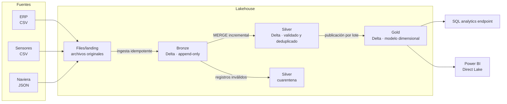

# Arquitectura

## Contexto

AgroExport Demo es una agroexportadora **ficticia** con dos sociedades (CR01 Costa Rica y GT01 Guatemala) que exporta fruta fresca y procesada. Su almacén de ventas y cartera vive en SQL Server ([agroexport-analytics](https://github.com/Joseph5712/agroexport-analytics)).

La operación incorporó fuentes que un almacén relacional maneja mal: lecturas de sensores cada cinco minutos y eventos semiestructurados de navieras. Este proyecto construye una plataforma lakehouse para integrarlas con los datos del ERP.

## Preguntas de negocio

| Área | Pregunta |
|---|---|
| Calidad | ¿Qué lotes salieron del rango de temperatura de su producto, cuándo y por cuánto tiempo? |
| Planta | ¿Qué cuartos fríos acumulan más excursiones de temperatura? |
| Logística | ¿Qué contenedores llegan después de su ETA y en qué tramo se generó el retraso? |
| Gerencia | ¿Cuántos kg en inventario o en tránsito están en riesgo por cadena de frío? |
| Ingeniería | ¿Qué archivo y qué ejecución produjo cada dato publicado? |

## Fuentes

| Fuente | Formato | Frecuencia | Contenido | Comportamientos a manejar |
|---|---|---|---|---|
| ERP | CSV | Diaria | Lotes, productos con su rango de temperatura, embarques y contenedores | Correcciones de registros ya enviados |
| Sensores de cuartos fríos | CSV por cuarto y hora | Lecturas cada 5 min | Temperatura y humedad por cuarto | Alto volumen, lecturas duplicadas, sensores que envían horas o días después |
| Naviera | JSON por lote de eventos | Cada hora | Eventos del contenedor: carga, zarpe, arribo, descarga, temperatura del reefer | Esquema que evoluciona, eventos fuera de orden |

## Arquitectura medallion

| Capa | Contenido | Reglas |
|---|---|---|
| **Files/landing** | Archivos tal como llegan, organizados por fuente y fecha de llegada | No se modifican |
| **Bronze** | Un registro por registro de origen, con el contenido original y metadatos de ingesta (`_source_file`, `_file_sha256`, `_ingested_at`, `_batch_id`) | Solo se agregan filas. Un archivo ya ingerido no se vuelve a ingerir |
| **Silver** | Tipos correctos, claves de negocio, un registro por clave y registros inválidos separados en cuarentena | Carga incremental con `MERGE` sobre la clave de negocio |
| **Gold** | Dimensiones, hechos e indicadores de cadena de frío y tránsito | Se publica por lote; el consumo lee solo lotes completos |

## Garantías de diseño

| Situación | Comportamiento |
|---|---|
| El mismo archivo llega dos veces | Bronze lo identifica por su huella SHA-256 y no lo vuelve a ingerir |
| Lectura duplicada del mismo sensor y minuto | Silver conserva un registro por clave |
| Lecturas que llegan días después | Se recalculan solo las fechas afectadas en Silver y Gold |
| La naviera agrega un campo | Bronze lo conserva en el contenido original; Silver lo incorpora de forma explícita |
| Fallo a mitad de la publicación de Gold | El consumo sigue leyendo el último lote completo |
| Auditoría de un valor publicado | Cada fila Gold referencia su lote; el historial Delta permite consultar versiones anteriores |

Delta Lake confirma cada escritura de forma atómica **por tabla**, pero no ofrece transacciones entre varias tablas. Por eso Gold se publica con un identificador de lote y un registro de publicación que se escribe al final: las vistas de consumo filtran por el último lote registrado.

## Entorno

El desarrollo es local primero, con las mismas versiones principales que Microsoft Fabric Runtime 1.3:

| Componente | Local (Docker) | Microsoft Fabric |
|---|---|---|
| Spark | 3.5.3 | Runtime 1.3 (Spark 3.5) |
| Delta Lake | 3.2.1 | Runtime 1.3 (Delta 3.2) |
| Python | 3.11 | Runtime 1.3 (Python 3.11) |
| Almacenamiento | `data/` en el contenedor (Docker Compose o Codespaces) | OneLake |
| Raíz configurable | `LAKEHOUSE_ROOT=/workspace/data` | Ruta `abfss://` del Lakehouse |
| Sesión Spark | `lakehouse.spark.get_spark()` | Variable `spark` del notebook |
| Orquestación | CLI `python -m lakehouse` | Data Pipeline |
| Consumo | Spark SQL | SQL analytics endpoint y Power BI (Direct Lake) |

La lógica de transformación vive en el paquete `lakehouse` y no depende del entorno: los notebooks de Fabric la reutilizan sin cambios.

## Plan de trabajo

| Fase | Alcance | Estado |
|---|---|---|
| 0 | Diseño, entorno local y verificación de Delta Lake | ✅ |
| 1 | Generadores de las tres fuentes con defectos controlados | ⏳ |
| 2 | Bronze: ingesta idempotente con metadatos | ⏳ |
| 3 | Silver: tipado, deduplicación, cuarentena y `MERGE` incremental | ⏳ |
| 4 | Gold: modelo dimensional, indicadores y publicación por lote | ⏳ |
| 5 | Datos tardíos, reproceso, pruebas de calidad y medición de rendimiento | ⏳ |
| 6 | Despliegue en Microsoft Fabric: Lakehouse, notebooks, pipeline y Power BI | ⏳ |
| 7 | Documentación final y demostración | ⏳ |
