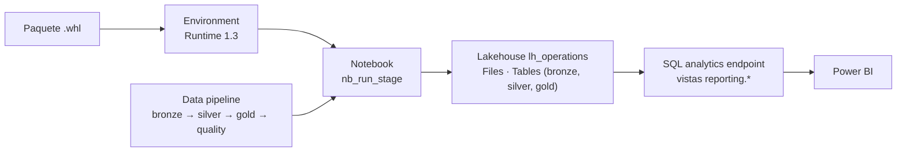

# Despliegue en Microsoft Fabric

El mismo paquete `lakehouse` que se ejecuta en Docker se instala en un entorno de Fabric. Los notebooks solo pasan parámetros y la lógica no se duplica.



| Elemento | Nombre | Archivo |
|---|---|---|
| Área de trabajo | `operations-lakehouse` | — |
| Lakehouse (con esquemas) | `lh_operations` | — |
| Entorno | `env_operations` | Paquete `operations_lakehouse-*.whl` |
| Notebook de ejecución | `nb_run_stage` | [fabric/notebooks/nb_run_stage.ipynb](../fabric/notebooks/nb_run_stage.ipynb) |
| Notebook de consulta | `nb_explore_gold` | [fabric/notebooks/nb_explore_gold.ipynb](../fabric/notebooks/nb_explore_gold.ipynb) |
| Pipeline | `pl_operations_daily` | — |
| Vistas de consumo | Esquema `reporting` | [fabric/sql/reporting_views.sql](../fabric/sql/reporting_views.sql) |
| Medidas | — | [fabric/powerbi/measures.dax](../fabric/powerbi/measures.dax) |

Los nombres del área de trabajo y del Lakehouse forman la ruta de OneLake (`abfss://<área>@onelake.dfs.fabric.microsoft.com/<lakehouse>.Lakehouse`), por eso no llevan espacios. Si usas otros nombres, cámbialos en los parámetros de los notebooks.

## 1. Construir el paquete

En el entorno de desarrollo (Codespaces o Docker):

```bash
pip wheel . --no-deps --no-build-isolation -w dist
```

El archivo `dist/operations_lakehouse-<versión>-py3-none-any.whl` incluye el código y los datos de referencia. Spark y Delta Lake no se empaquetan porque los provee el Runtime de Fabric.

## 2. Área de trabajo y Lakehouse

1. En [app.fabric.microsoft.com](https://app.fabric.microsoft.com): **Áreas de trabajo → Nueva área de trabajo**, nombre `operations-lakehouse`. En **Avanzado**, modo de licencia **Prueba** (Trial).
2. En el área de trabajo: **Nuevo elemento → Lakehouse**, nombre `lh_operations`, con la opción **Esquemas de Lakehouse** activada. Con esquemas, las carpetas `Tables/bronze`, `Tables/silver` y `Tables/gold` aparecen como esquemas, y el SQL analytics endpoint las expone como `bronze.*`, `silver.*` y `gold.*`.

## 3. Entorno con el paquete

1. **Nuevo elemento → Entorno**, nombre `env_operations`.
2. **Runtime 1.3** (Spark 3.5, Delta Lake 3.2): las mismas versiones del entorno local.
3. **Bibliotecas personalizadas → Cargar** el `.whl`.
4. **Guardar** y **Publicar**. La publicación tarda unos minutos.

Para una versión nueva del paquete, se carga el nuevo `.whl`, se elimina el anterior y se vuelve a publicar.

## 4. Notebooks

1. En el área de trabajo: **Importar → Notebook → Desde este equipo**, y elige los dos `.ipynb` de `fabric/notebooks`.
2. En cada notebook:
   - Panel **Lakehouses → Agregar → Lakehouse existente → `lh_operations`**. Queda como Lakehouse predeterminado y se monta en `/lakehouse/default`.
   - Selector de **Entorno → `env_operations`**.
3. En `nb_run_stage`, la segunda celda debe mostrar la etiqueta **Parámetros**. Si no la muestra: **⋯ → Alternar celda de parámetros**.

## 5. Primera llegada de archivos

En `nb_run_stage`, cambia los parámetros y ejecuta todo:

```python
stage = "generate"
until = "2026-10-13"
```

El resumen debe indicar 84 archivos del ERP, 207 de sensores y 39 de la naviera. Los archivos quedan en **Files/landing** del Lakehouse.

## 6. Pipeline

1. **Nuevo elemento → Canalización de datos**, nombre `pl_operations_daily`.
2. Agrega cuatro actividades **Notebook**, todas con el notebook `nb_run_stage`, y en **Configuración → Parámetros base** un parámetro `stage` de tipo String:

   | Actividad | `stage` |
   |---|---|
   | `act_bronze` | `bronze` |
   | `act_silver` | `silver` |
   | `act_gold` | `gold` |
   | `act_quality` | `quality` |

3. Conecta cada actividad con la siguiente por la salida **Al completarse correctamente** (verde).
4. **Ejecutar**. En el **Centro de supervisión** se ve cada actividad y, en su salida, el resumen que devuelve el notebook.

Resultado esperado de la primera ejecución: `act_quality` termina correctamente con 23 PASS y 1 WARN, por los tres días sin lecturas de `GT01-ESC-01`. Un WARN no detiene el pipeline; un FAIL sí.

## 7. Segunda llegada: datos tardíos

1. En `nb_run_stage`, con `stage = "generate"` y `until = ""`, ejecuta todo. Llegan los archivos restantes, incluidos los días atrasados de Guatemala.
2. Vuelve a ejecutar el pipeline.

Resultado esperado: Bronze lote 2 con un archivo `SKIPPED_DUPLICATE`, Gold publicación 2 y 24 controles en PASS.

Para ejecutarlo a diario: **Programar** en el pipeline. Desactiva la programación al terminar las pruebas para no consumir capacidad.

## 8. Vistas de consumo

1. Abre el Lakehouse y cambia a **SQL analytics endpoint**.
2. **Nueva consulta SQL**, pega [reporting_views.sql](../fabric/sql/reporting_views.sql) y ejecútala. Si el editor no acepta varios lotes, ejecuta cada bloque entre `GO` por separado.
3. La consulta final debe devolver 6 lotes `COMPROMETIDO`, 11 `EN_RIESGO` y 288 `OK`.

Las vistas filtran la publicación vigente de Gold. Así un reporte nunca combina la publicación vigente con la anterior, que Gold conserva para poder volver a ella.

## 9. Power BI

1. En el SQL analytics endpoint: **Configuración → Cadena de conexión SQL → Copiar**.
2. En Power BI Desktop: **Obtener datos → SQL Server**, pega la cadena como servidor, base de datos `lh_operations` y modo **DirectQuery**. Autentícate con tu cuenta de la organización.
3. Selecciona las vistas del esquema `reporting`.
4. Relaciones (uno a varios, filtro en una dirección):

   | Desde (1) | Hacia (*) |
   |---|---|
   | `dim_cold_room[room_code]` | `fact_cold_room_daily[room_code]`, `fact_cold_room_excursion[room_code]`, `fact_lot_cold_chain[cold_room_code]` |
   | `dim_product[product_code]` | `fact_lot_cold_chain[product_code]` |
   | `fact_container_transit[shipment_number]` | `fact_lot_cold_chain[shipment_number]` |

5. Agrega las medidas de [measures.dax](../fabric/powerbi/measures.dax).
6. Páginas sugeridas:

   | Página | Contenido |
   |---|---|
   | Cadena de frío | Tarjetas: Kg Comprometidos, Kg en Riesgo, % Kg Comprometidos. Tabla de lotes con su estado, cuarto, embarque y exposición |
   | Cuartos fríos | Línea de `avg_temp_c` por día y cuarto, con `min_temp_c` y `max_temp_c` del cuarto como referencia. Tabla de excursiones |
   | Tránsito | Embarques con retraso por puerto de destino. Tabla de contenedores con temperatura fuera de rango |
   | Estado de los datos | `Texto Estado de Datos` y tabla de `quality_checks` |

7. **Publicar** en el área de trabajo `operations-lakehouse`.

**Por qué DirectQuery y no Direct Lake:** Direct Lake lee tablas Delta, no vistas. Si el modelo leyera las tablas Gold directamente, vería la publicación vigente y la anterior juntas y contaría dos veces. Con las vistas, el reporte siempre ve una sola publicación completa. Gold tiene pocas filas, por lo que DirectQuery responde rápido.

## Problemas frecuentes

| Síntoma | Causa | Solución |
|---|---|---|
| `ModuleNotFoundError: lakehouse` | El notebook no tiene el entorno o el entorno no está publicado | Selecciona `env_operations` y verifica que la publicación terminó |
| `/lakehouse/default/Files` no existe | El notebook no tiene Lakehouse predeterminado | Agrega `lh_operations` en el panel Lakehouses |
| Error de ruta `abfss://` no encontrada | Los parámetros no coinciden con los nombres reales | Ajusta `workspace_name` y `lakehouse_name` |
| Las tablas aparecen como *Unidentified* | El Lakehouse se creó sin esquemas | Crea un Lakehouse nuevo con **Esquemas de Lakehouse** activado |
| La actividad de calidad falla | Un control terminó en FAIL | El detalle está en la salida de la actividad y en `gold.quality_checks` |

## Evidencia

Capturas para `docs/img/`:

1. El Lakehouse con los esquemas `bronze`, `silver` y `gold` y sus tablas.
2. La ejecución del pipeline con las cuatro actividades correctas.
3. La salida de `act_quality` de la primera ejecución, con el WARN de cobertura.
4. El resultado de la consulta de verificación de las vistas.
5. Cada página del reporte de Power BI.
